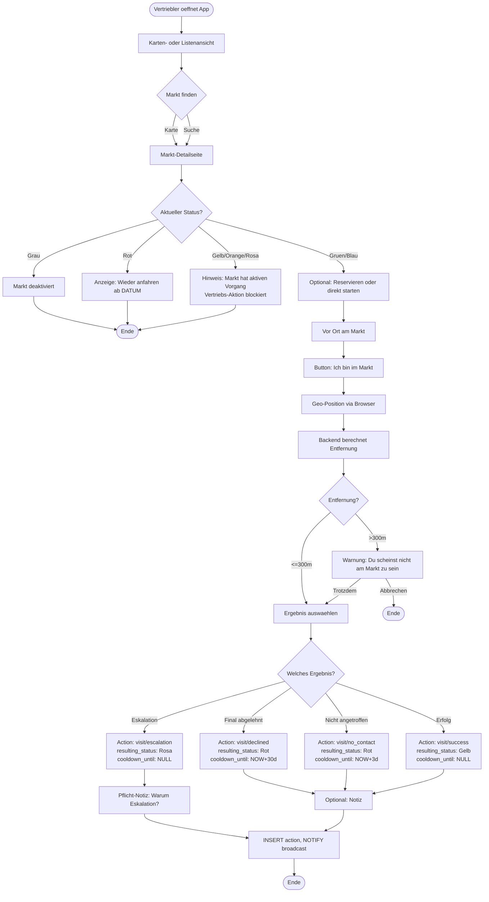
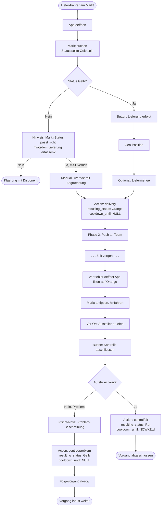
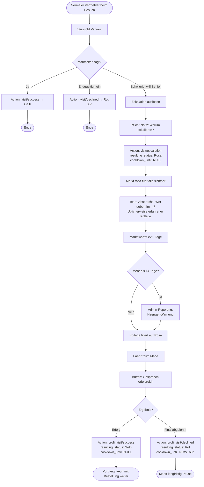
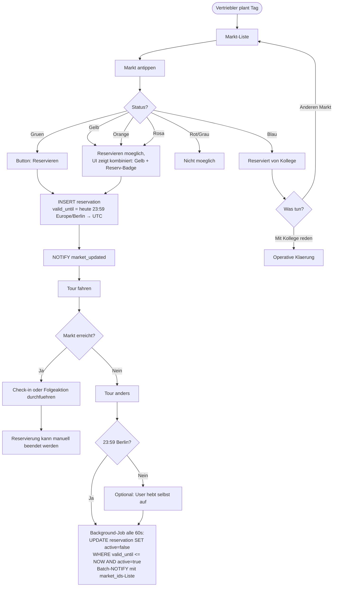
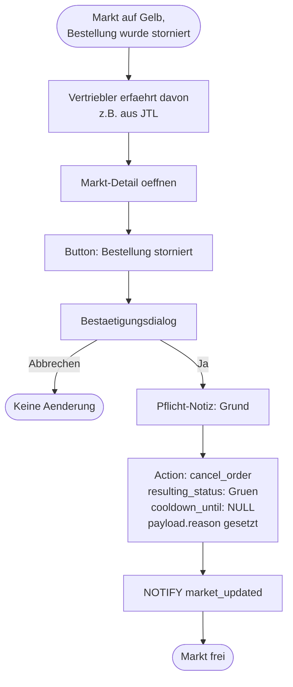
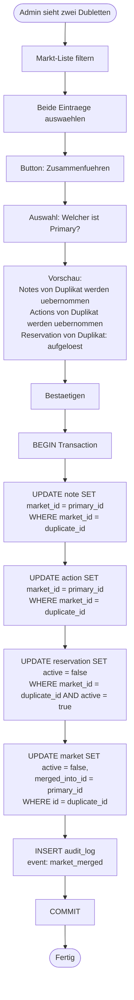

# Aktivitätsdiagramme

Workflows aus Nutzersicht. Ergänzt das State-Diagramm um die menschliche Perspektive.

**Cooldown-Logik:** Ein Cooldown wird **pro Aktion einzeln** als Snapshot in `action.cooldown_until` gespeichert. Bei `duration_days = 0` wird `NULL` geschrieben – kein Cooldown. Bei `visit/success` ist die Regel 0, der Markt wartet auf Lieferung und ist nicht gesperrt. Bei `control/ok` greift der 21-Tage-Cooldown.

## 1. Vertriebsbesuch durchführen

## 2. Lieferung + Kontrolle

## 3. Eskalation + persönliches Gespräch

**Hinweis:** Wer direkt zu einem grünen Markt fährt (ohne dass jemand eskaliert hat), macht einen normalen `visit`, keinen `profi_visit`. Der Trigger blockiert `profi_visit` auf grünen Märkten (P0005). Das DB-Action-Type `profi_visit` (UI: „Persönliches Gespräch") ist immer Reaktion auf einen Rosa-Markt.

## 4. Reservierung

**Reservierungs-Regeln** (Backend-erzwungen, nicht im Trigger):
- Erlaubt auf: Grün, Gelb, Orange, Rosa
- Verboten auf: Blau (gibt's nur als Anzeige), Rot, Grau
- Max. 1 aktive Reservierung pro Markt
- Auto-Reset um 23:59 Europe/Berlin
- Idempotent: wenn Job mal aussetzt (Deployment), wird beim nächsten Lauf nachgeholt

## 5. Stornierung

`cancel_order` ist nur bei Gelb sinnvoll und nur dort erlaubt. Auf anderen Status blockt der Trigger: P0001 bei aktivem Vorgang (Orange/Rosa), P0005 bei Grün, P0002 bei Rot mit Cooldown, P0003 bei Merged, P0004 bei inaktiv. Trigger-Code-Übersicht: siehe `docs/Reference.md`.

## 6. Markt-Merge (Admin)

**Nach Merge:** Insert-Versuche auf den gemergten Markt werden vom Trigger mit P0003 geblockt. Frontend muss bei alten URLs auf den Primary umleiten.
