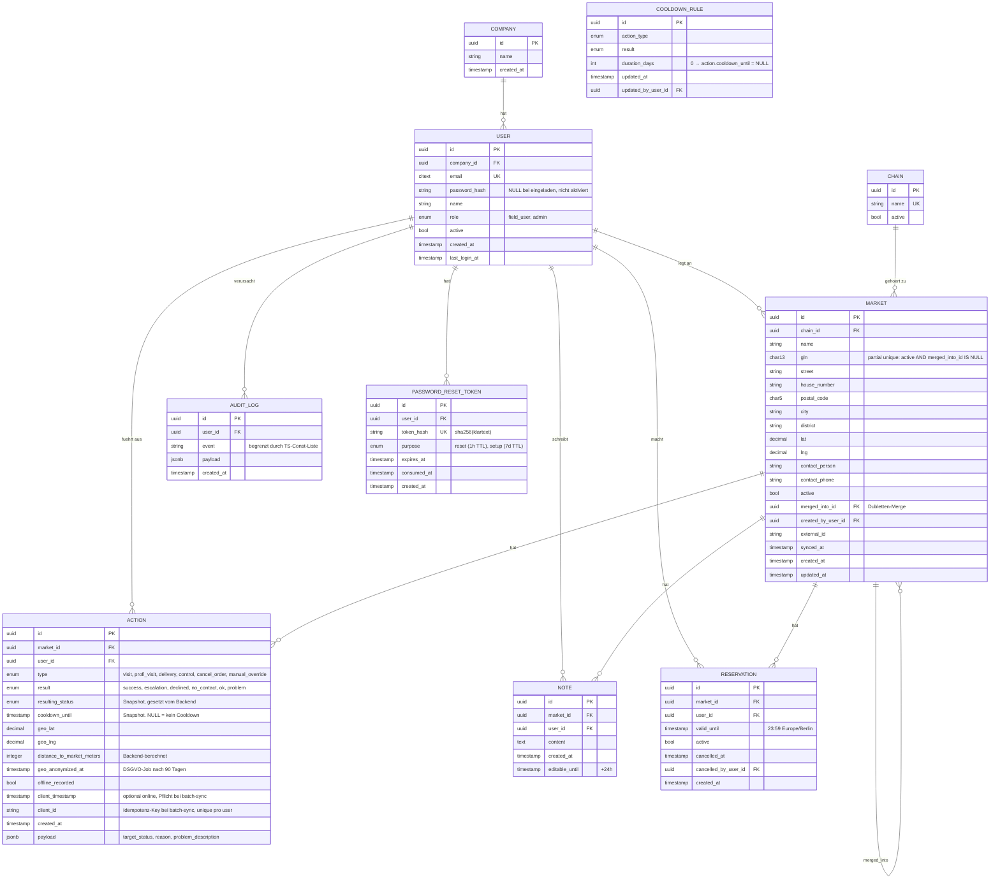

# ER-Diagramm: Datenmodell MarktSync v0.6

## Designentscheidungen

### 1. Status berechnet, `resulting_status` als Snapshot
View `v_market_status` nimmt die letzte Action und ihren Cooldown. Single source of truth ohne komplexe CASE-Logik.

### 2. `cooldown_until` als Snapshot, NULL = kein Cooldown
- Beim INSERT: `duration_days = 0` → `cooldown_until = NULL`
- Spätere Änderungen an `cooldown_rule` betreffen nur neue Actions
- View prüft: `cooldown_until IS NOT NULL AND cooldown_until > NOW`

### 3. `client_id` als Idempotenz-Key
- Frontend generiert UUID pro Offline-Action
- Backend: `UNIQUE (user_id, client_id) WHERE client_id IS NOT NULL`
- Doppel-Sync gleicher Aktion wird stillschweigend ignoriert (kein Fehler)
- Bei Online-Actions: `client_id = NULL`

### 4. Action-Stream als Single Source of Truth
Historie, Status, Cooldown – alles über Aktionen rekonstruierbar.

### 5. Reservierung als separate Tabelle
Parallel-Dimension zum Status. Eigenes Lifecycle.

### 6. Konkurrenz-Schutz auf zwei Ebenen
- DB-Trigger `enforce_single_active_vorgang` nimmt selbst `pg_advisory_xact_lock(hashtext(market_id))`
- Backend nimmt denselben Lock zusätzlich vor dem Insert
- Bei direkten SQL-Inserts (Migrations, Bugfixes) schützt der Trigger weiterhin
- Partial unique index blockiert doppelte aktive Reservierungen

### 7. Soft-Delete + Merge
- Märkte nie hart gelöscht
- `merged_into_id` zeigt auf verbleibenden, `active = false`
- Trigger blockiert Inserts auf gemergte Märkte (P0003)
- View filtert gemergte raus

### 8. GLN partial unique
- Eindeutig nur für `active = TRUE AND merged_into_id IS NULL`
- Wiederverwendung der GLN nach Schließung möglich

### 9. Geo-Anonymisierung nach 90 Tagen
- `geo_anonymized_at` markiert anonymisierte Actions
- Background-Job läuft täglich

### 10. Password-Reset und Setup teilen Tabelle
- `purpose` unterscheidet
- TTL: Setup 7d, Reset 1h
- `token_hash` ist SHA-256 (nicht Klartext)

### 11. Audit-Log mit kontrollierten Events
- `event` ist VARCHAR, aber Backend setzt nur Werte aus TypeScript-Const-Liste
- Tippfehler werden zur Compile-Zeit erwischt
- Vollständige Liste im `database-schema.sql` und Domain-Skill

## Indizes-Übersicht

| Index | Zweck |
|-------|-------|
| `idx_action_market_created` `(market_id, created_at DESC)` | Status-Berechnung (letzte Action holen) |
| `idx_action_cooldown_until` `(cooldown_until) WHERE cooldown_until IS NOT NULL` | Cooldown-Ablauf-Job |
| `idx_action_geo_anonymize` `(created_at) WHERE geo_anonymized_at IS NULL` | Anonymisierungs-Job |
| `idx_action_client_id` `(user_id, client_id) WHERE client_id IS NOT NULL` | Idempotenz für Offline-Sync |
| `idx_market_name_trgm` (GIN-Trigram) | Markt-Suche |
| `idx_market_gln_active` (partial unique) | GLN-Eindeutigkeit |
| `idx_market_created_at` `(created_at DESC)` | „Neue Märkte"-Report |
| `idx_reservation_one_active_per_market` (partial unique) | 1 aktive Reservierung pro Markt |
