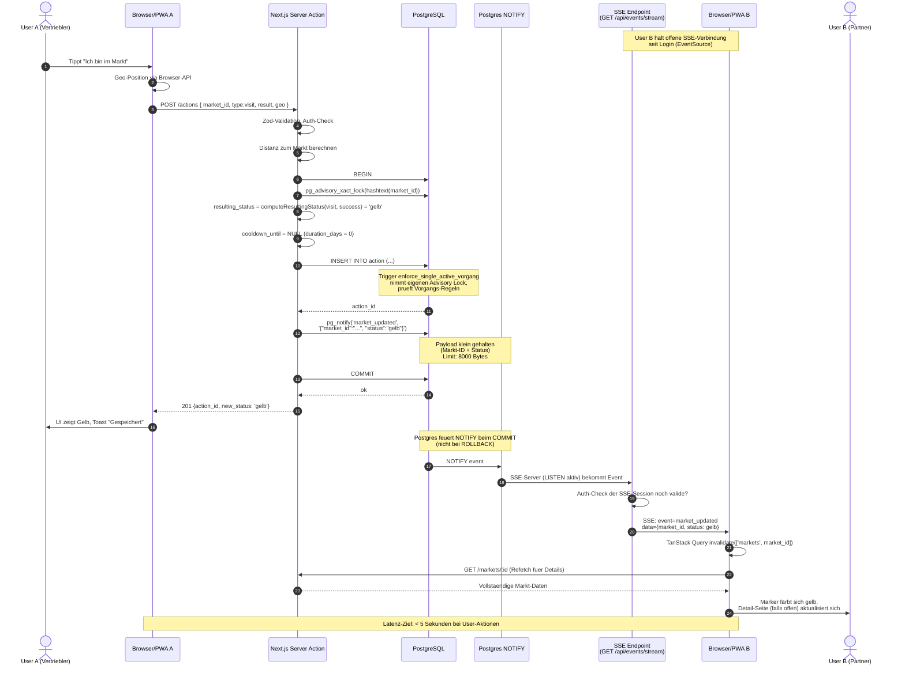
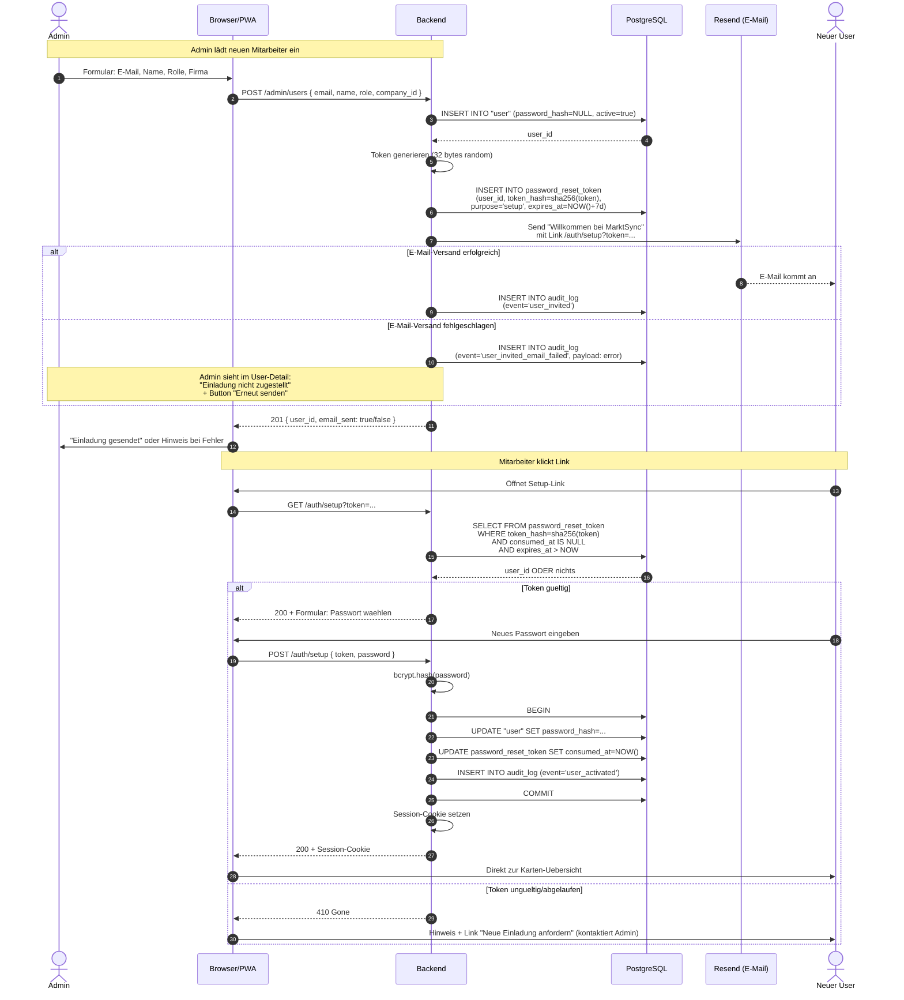
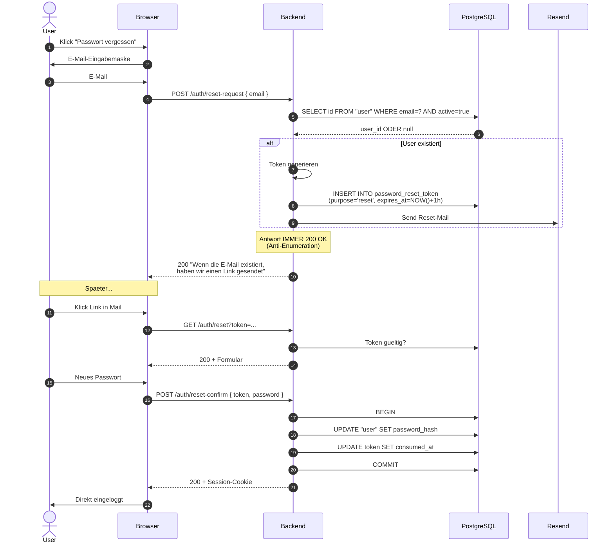
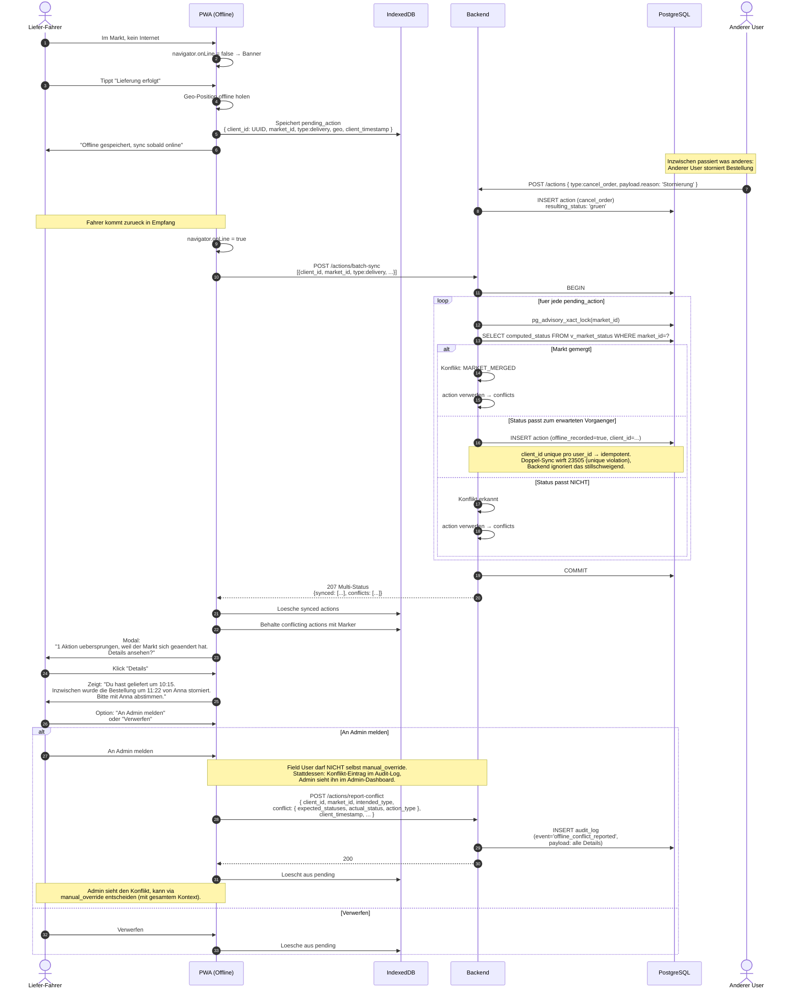
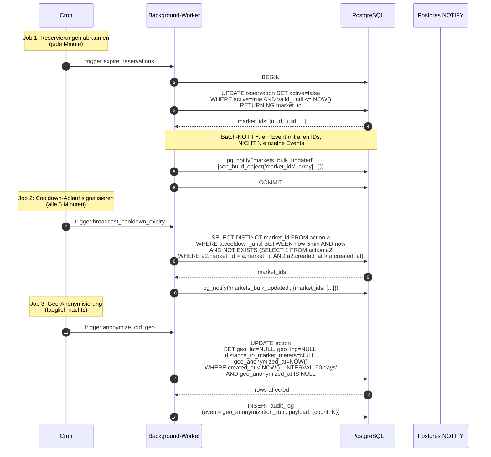

# Sequenzdiagramme

Technische Abläufe zwischen den Komponenten. **Realtime läuft über PostgreSQL LISTEN/NOTIFY + Server-Sent Events (SSE), nicht über WebSockets.** Begründung siehe `Tech-Stack.md`.

## 1. Realtime-Sync: Status-Änderung an aktive User

**Hinweis zur NOTIFY-Payload:** Postgres NOTIFY hat ein 8000-Byte-Limit (inkl. Channel-Name). Daher senden wir nur Markt-ID und neuen Status. Frontend macht für Details einen REST-Refetch über TanStack Query. Bei großen Updates (z. B. Bulk-Reservierungs-Ablauf) bündeln wir mehrere Markt-IDs in einem Event statt viele Einzel-Events zu feuern.

**Postgres-Channels (kanonische Liste, siehe `docs/Reference.md`):**
- `market_updated` für Einzel-Events nach User-Aktionen und Reservation-Insert/Cancel
- `markets_bulk_updated` für Background-Job-Bulk-Events (Reservierungs-Ablauf, Cooldown-Ablauf)

Genau diese zwei. SSE-Server `LISTEN`t auf beide.

**SSE-Architektur** (siehe `docs/Reference.md` → „SSE-Architektur"): Eine dedizierte DB-Connection außerhalb des Pools hält permanent die LISTEN-Aufrufe. Beim Server-Start instanziiert, beim Shutdown sauber beendet. Browser-Reconnect bei Server-Restart wird über EventSource-Default-Backoff abgefangen.

**SSE-Auth:** Session-Cookie wird automatisch mitgeschickt (HttpOnly, SameSite=Lax). SSE-Server prüft bei jedem Heartbeat (alle 30s) ob die Session noch valide ist. Bei Ablauf: SSE-Connection wird geschlossen, Client-EventSource macht Auto-Reconnect → der nächste Reconnect schlägt mit 401 fehl → Frontend leitet zum Login-Screen.

## 2. Login + Setup für eingeladene User

## 3. Passwort-Reset (vergessen)

**Token-TTLs:** Setup-Token 7 Tage, Reset-Token 1 Stunde.

## 4. Offline-Sync mit Konflikt-Behandlung

**Wichtig zu Berechtigungen:** `manual_override` ist Admin-only (API gibt 403 für Field User). Field User können in Offline-Konflikten die Aktion verwerfen oder über einen Konflikt-Bericht an den Admin eskalieren. Der Admin sieht alle Konflikt-Berichte im Dashboard und kann mit vollem Kontext entscheiden.

### Erwartete Vorgänger-Status pro Action-Type

Vom Backend für Offline-Sync verwendet:

| Action-Type | Erwarteter Vorgänger-Status |
|-------------|----------------------------|
| `visit` (alle results) | Grün oder Blau |
| `profi_visit` | Rosa |
| `delivery` | Gelb |
| `control` | Orange |
| `cancel_order` | Gelb |
| `manual_override` | beliebig (darf immer) |

**Zusätzliche Konflikt-Gründe** (im strukturierten `conflict`-Objekt oder als `code`-Feld):
- Status-Mismatch: `{ expected_statuses: [...], actual_status, action_type }` (siehe `docs/Reference.md` für die erwarteten Vorgänger pro Action-Type)
- `MARKET_MERGED` – Markt wurde inzwischen gemergt
- `MARKET_INACTIVE` – Markt wurde inzwischen deaktiviert
- `USER_DEACTIVATED` – User wurde inzwischen deaktiviert
- `DUPLICATE_CLIENT_ID` – Action wurde schon einmal gesynct (idempotent ignoriert, nicht als Fehler)

## 5. Background-Jobs

Drei wiederkehrende Jobs, alle idempotent.

**Idempotenz-Garantien:**
- Job 1 (`expire_reservations`) ist idempotent: filtert auf `active=true AND valid_until <= NOW`. Mehrfache Aufrufe sind unschädlich. Wenn der Job während eines Deployments einen Lauf verpasst (z. B. 23:58–00:01), holt er die abgelaufenen Reservierungen beim nächsten Lauf nach. Max. zusätzliche Verzögerung: 1 Minute.
- Job 2 (`broadcast_cooldown_expiry`) feuert nur informativ – bei Skip einfach Skip. Worst Case: User sieht den Markt bis zu 5 Minuten verzögert als „nicht mehr rot".
- Job 3 (`anonymize_old_geo`) filtert auf `geo_anonymized_at IS NULL`. Bei Skip einfach Skip, beim nächsten Lauf nachgeholt.

**Hinweis zur Latenz-Vorgabe:** Die „< 5 Sekunden"-Vorgabe aus dem Lastenheft gilt für **User-getriggerte Aktionen** (visit, delivery, control, cancel_order, manual_override). Für **systemgetriggerte Status-Wechsel** (Reservierungs-Ablauf, Cooldown-Ablauf) gilt eine entspanntere Toleranz: bis zu 1 Minute für Reservierungs-Ablauf, bis zu 5 Minuten für Cooldown-Ablauf.
