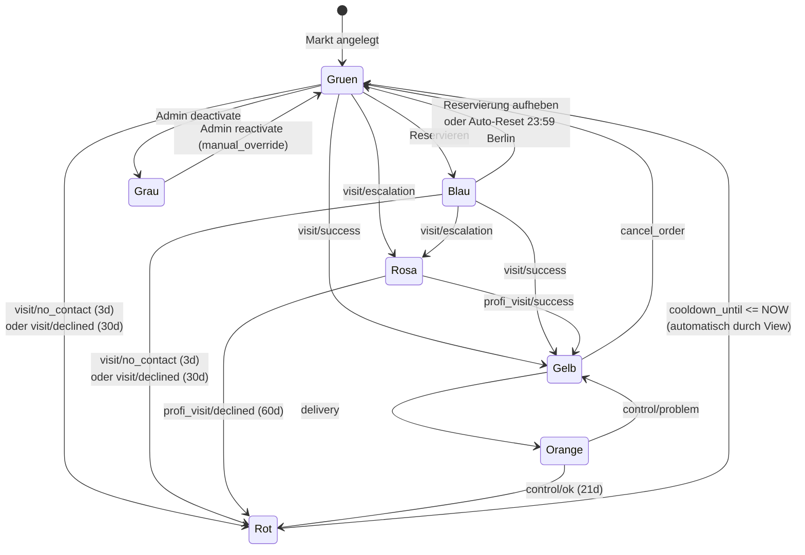

# State-Diagramm: Markt-Status

Beschreibt alle erlaubten Übergänge zwischen Markt-Status. Was hier nicht steht, ist verboten und wird vom Trigger `enforce_single_active_vorgang` geblockt.

## Übersicht



> **Reservierung ist Parallel-Dimension** und nicht vollständig in dieser Statemachine abgebildet. Das Diagramm zeigt nur den prototypischen Grün↔Blau-Übergang. Tatsächlich kann eine Reservierung auch auf Gelb, Orange und Rosa parallel bestehen – UI zeigt dann den jeweiligen Status mit Reservierungs-Badge. Vollständige Reservierungs-Regeln siehe unten.

## Status-Bedeutungen

| Status | Hex | Bedeutung | Cooldown |
|--------|-----|-----------|----------|
| Gruen | `#22C55E` | Frei | – |
| Blau | `#3B82F6` | Reserviert für heute | Reservation läuft 23:59 Berlin |
| Gelb | `#EAB308` | Vertrieb war da, wartet auf Lieferung | KEIN Cooldown |
| Orange | `#F97316` | Geliefert, Kontrolle nötig | KEIN Cooldown |
| Rosa | `#EC4899` | Persönliches Gespräch nötig (Eskalation) | KEIN Cooldown |
| Rot | `#EF4444` | Cooldown läuft | `cooldown_until > NOW` |
| Grau | `#6B7280` | Inaktiv | – |

## Status-Berechnung

Status wird **nicht in `market` gespeichert**, sondern über die View `v_market_status` berechnet:

```
1. market.active = false             → grau
2. cooldown_until > NOW (nicht NULL) → rot
3. Sonst: resulting_status der letzten Action
4. Keine Actions → gruen
```

Jede Action speichert bei der Erstellung ihren `resulting_status` und ihren `cooldown_until`. **Konvention**: `cooldown_until = NULL` bedeutet *kein* Cooldown. Bei `duration_days = 0` in `cooldown_rule` wird das Backend explizit `NULL` schreiben, nicht `NOW()`.

Spätere Änderungen an `cooldown_rule` wirken nur auf zukünftige Actions.

## Cooldown-Werte (Default, Admin-konfigurierbar)

| Action | Result | Cooldown | Resulting Status |
|--------|--------|----------|------------------|
| visit | success | 0 (NULL) | Gelb |
| visit | escalation | 0 (NULL) | Rosa |
| visit | no_contact | 3 Tage | Rot |
| visit | declined | 30 Tage | Rot |
| profi_visit | success | 0 (NULL) | Gelb |
| profi_visit | declined | 60 Tage | Rot |
| delivery | – | 0 (NULL) | Orange |
| control | ok | 21 Tage | Rot |
| control | problem | 0 (NULL) | Gelb |
| cancel_order | – | 0 (NULL) | Gruen |
| manual_override | – | 0 (NULL) | (laut target_status im payload) |

## Trigger-Regeln (vollständige Tabelle)

Diese Tabelle definiert verbindlich, **welche Aktion bei welchem Markt-Zustand erlaubt ist**. Implementiert in `enforce_single_active_vorgang()`. Alle nicht aufgeführten Kombinationen werden geblockt.

| Markt-Zustand | Erlaubte Aktionen | Geblockt durch |
|---------------|-------------------|----------------|
| Markt gemergt (`merged_into_id IS NOT NULL`) | nichts | P0003 |
| Markt inaktiv (`active = false`) | `manual_override` | P0004 |
| Cooldown läuft (`cooldown_until > NOW`) | `manual_override` | P0002 |
| Status Gelb | `delivery`, `cancel_order`, `manual_override` | P0001 |
| Status Orange | `control`, `manual_override` | P0001 |
| Status Rosa | `profi_visit`, `manual_override` | P0001 |
| Status Grün (oder Rot-mit-abgelaufenem-Cooldown) | `visit`, `manual_override` | P0005 |

**Manual Override darf immer.** Pflicht-Felder im payload: `target_status` (eines der 6 Status, NICHT 'blau') und `reason` (≥ 1 Zeichen).

**Wichtige Edge-Cases:**
- `profi_visit` (UI: „Persönliches Gespräch") direkt auf einen grünen Markt ist *nicht erlaubt*. Wer zu einem grünen Markt fährt, macht einen normalen `visit`.
- `cancel_order` ist nur auf Gelb sinnvoll und erlaubt. Auf anderen Status geblockt.
- `delivery` nur auf Gelb, `control` nur auf Orange. Strikt.
- `manual_override` auf Rot ohne Cooldown bleibt rot, bis nächste Action. Aus diesem Rot kommt der Markt *nicht* automatisch raus, weil kein Cooldown läuft. Das ist *by design*: Admin hat explizit so gesetzt. **UI zeigt in diesem Fall:** „Gesperrt durch Admin am `<Datum>` – Grund: `<reason>`" (statt „Wieder anfahren ab `<Datum>`"). Frontend nutzt dazu `last_action` aus der `GET /markets/:id`-Response.

## Reservierungs-Regeln (separate Tabelle, nicht im Trigger)

Reservierung ist Parallel-Dimension. Erlaubt auf:
- Grün
- **Gelb**
- Orange
- Rosa

Verboten auf:
- Blau (gibt es nur als Reservierungs-Anzeige eines grünen Marktes)
- Rot
- Grau

Reservierung beeinflusst `computed_status` nicht direkt. UI zeigt:
- Auf grünem Markt mit Reservation: **Blau** (gemerkt)
- Auf gelbem/orangem/rosa Markt mit Reservation: Status-Farbe + Zusatz-Badge

Auto-Reset um 23:59 Europe/Berlin durch Background-Job (idempotent, läuft jede Minute).

1 aktive Reservierung pro Markt (partial unique index).

## Manual-Override-Use-Cases

| Situation | target_status | reason |
|-----------|---------------|--------|
| Versehentlich falsche Action erfasst | passend, je nach Wunsch | „Korrektur: Tatsächlich nicht angetroffen" |
| Markt im Cooldown soll wieder frei | gruen | „Sonderfall: Marktleiter bat um neuen Termin" |
| Inaktiven Markt reaktivieren (über Admin-UI, intern via manual_override + Schema-Update) | gruen | „Markt wieder im Betrieb" |
| Konflikt-Auflösung nach Offline-Sync | je nach Situation | „Offline-Lieferung trotz inzwischen erfolgter Stornierung" |

**Out of Scope (nicht im MVP):**
- Admin setzt für einen anderen User eine Reservation an (manuelle Zuteilung). Falls später nötig, eigener Endpoint.
